#   Welcome to SEI: Learning Experience + Classroom Culture (90 min)

| Timing | Type 
| --- | ---
| 10 min | [Your Instructional Team](#introduction)
| 25 min | [Student Icebreaker](#student-icebreaker) 
| 10 min | [Schedule](#expectations) 
| 20 min | [Big Goals and Culture](#ga-culture) 
| 10 min | [Student Expectations](#student-expectations) 
| 10 min | [Plagiarism](#plagiarism) 
| 10 min | [Student Work](#student-work)
| 10 min | [Q&A](#questions) 
| 10 min | [Additional Installfest](#additional-installfest)

### LEARNING OBJECTIVES
*After this lesson, you will be able to:*

- Understand the expectations for the course.
- Align with the class on goals for the course.
- Get to know your classmates.
- Get familiar with class culture and big goals.

---

## Your Instructional Team (10 min)

#### Instructor Roles

1. Instructor Lead (Suresh)
     - Lesson blocks
     - Code-alongs
     - Labs
     - Instructor leads a unit
     - Grades projects
  
2. Instructor Associate (Dhrubo)
     - Morning exercises
     - Afternoon code reviews
     - Creates homework
     - Grades homework + projects

 

---

## Icebreaker (25 min)

We're going to pair you up in breakout rooms for 10 minutes. When we return, we'll ask you to introduce your partner by answering the following questions:

- Your partner's name and city
- What they were doing before joining this program
- Favorite hobby and/or interesting fact

 

## Daily Schedule

We will post screenshots of each Unit here. This plan is subject to change depending on pacing, guest speakers, hackathon planning, etc. 

#### Week 1

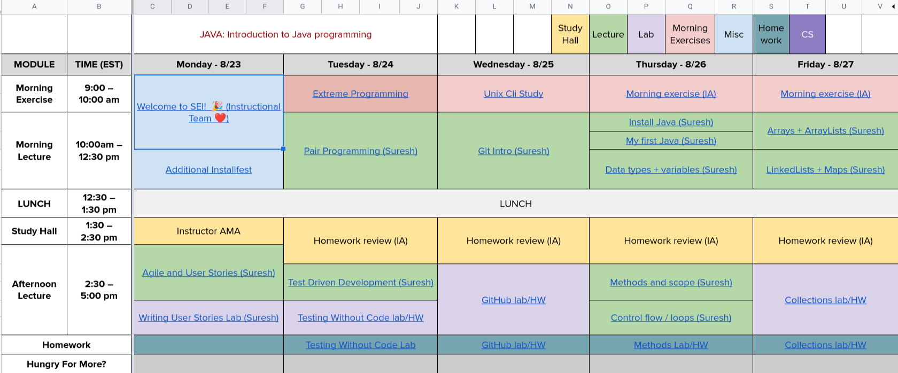

#### Week 2

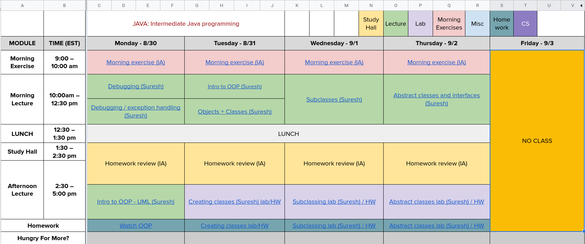

#### Week 3

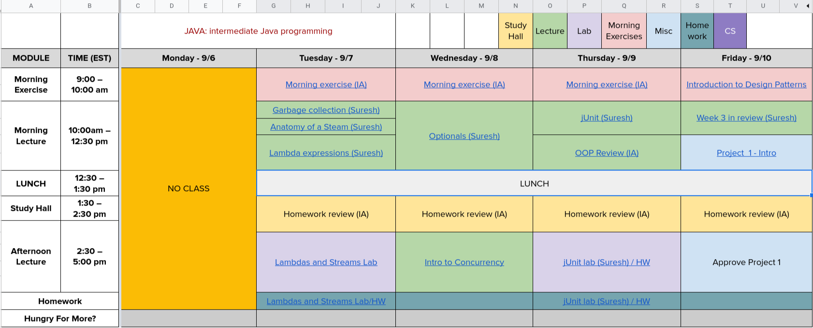

#### Week 4

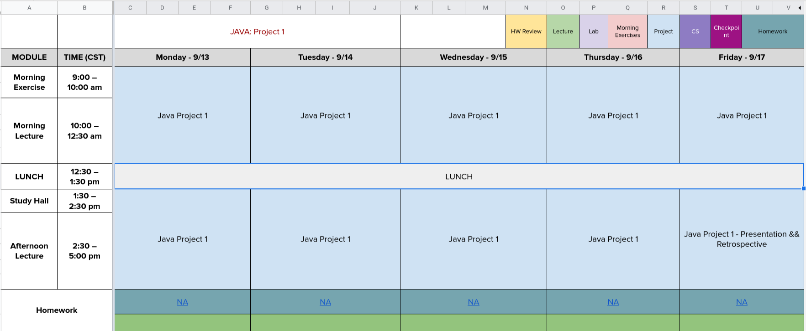

#### Week 5

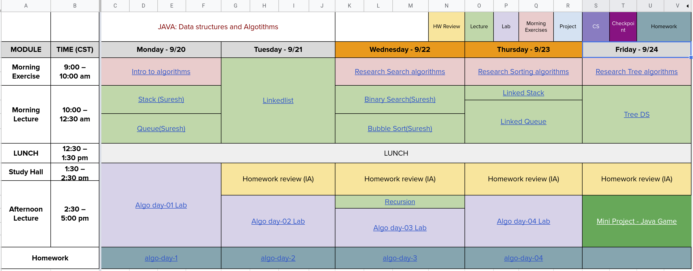

#### Week 6

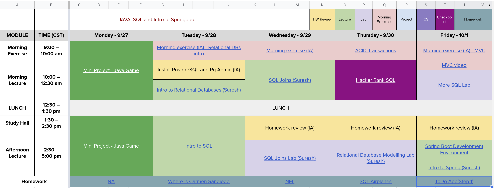

#### Week 7

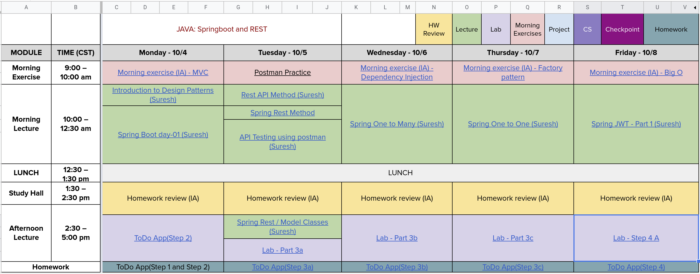

#### Week 8

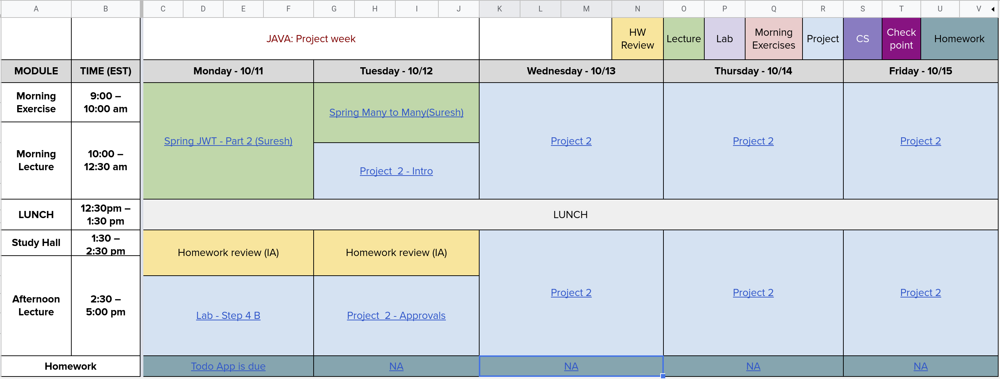

#### Week 9

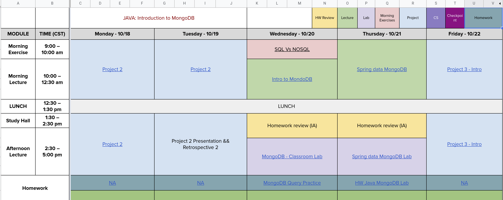

#### Week 10

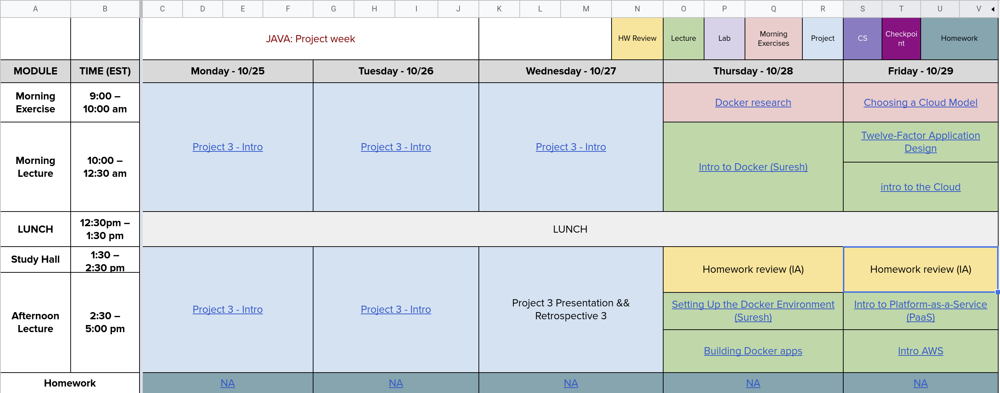

#### Week 11

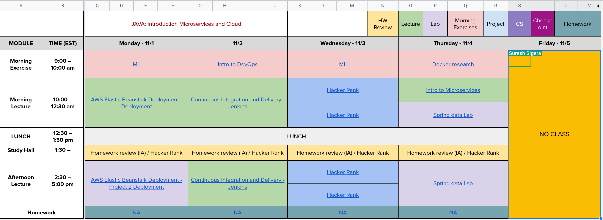

## Unit Breakdown

- Unit 1: Foundational Java - Suresh leads
- Unit 2: Springboot/Postgresql (Backend Development) - Suresh leads
- Unit 3: DevOps - Suresh leads
- Unit 4: Cloud Infrastructure - Suresh leads

 

## What to Expect (10 min)

#### Emotional Framing
- Programming is not about learning a sequence of steps. It's about developing a mindset to solve problems and think programmatically.
- Programming language not as important as:
    - Critical/analytical/programmatic thinking.
    - Conceptualizing, not simply memorizing, ideas.
        - The internet is your notebook/memory.
    - Being able to adapt quickly.
- Deal with the chaos in your head. Being confused/lost is NORMAL. No one pays you because you know all the answers. A developer's job is to jump into confusion and find a solution.
- Development can be very personal. It's about:
    - Debugging your own mistakes.
    - Being a good "Googler" and reading tech documents takes practice.
    - Learning more by doing rather than by listening.
- We try not to hold your hand.
    - A decent amount of failure happens initially when learning web development.
        - Getting that out of the way before we start working is good.
- This course is hard work: Be prepared to devote 60-70 hours a week, minimum.
- The maximum point of learning is right at the edge of learning and panic.

 

 

- This experience will be a roller coaster.

 

 

## GA Big Goals and Culture (10 min)

- Big Goals: What do you want to accomplish in this course?
- Culture: How do you want to get there?

**YOU DO (10 min)**

In breakout rooms, discuss the Big Goals and Culture for this course. We'll come back and share out.

    
Classroom Culture

#### Classroom Culture
- This is an open, safe environment.
- Keep criticism positive and constructive.
- Take ownership of your experience.
- Check your ego at the door.
- Channel empathy.
- Don't compare yourself to others; compare yourself to who you were yesterday.
- You get back what you put in.

#### Mentorship Culture
- GA is collaborative and supportive; we lead by offering help.
- Some students are good at one thing, others at another. Leverage each other's strengths.
- Teaching is the best way to solidify your understanding of a concept.
- Your classmates will be the best foundation for establishing a professional network in tech!

 

## Student Expectations (15 min)
1. Be Present.
 - We take attendance at 9:05 a.m. PST
 - Pay attention.
 - Please Slack message Dhrubo if you are running late
 - Concerning excused absences:
 - Multiple instances of tardiness = absence.
 - You must stay below the contractual limit for absences to complete the course successfully.
2. Be Persistent
3. Be Independent
4. Be Thoughtful
5. Be Creative
 - This coursework is not "paint by numbers".
6. Be Alert and Mindful, not Distracted
7. Have your webcam on

 

## Plagiarism (10 min)

[Plagiarism Readme](plagiarism.md)

 

## Q&A

 

## Additional Installfest

[Installfest Repo](https://git.generalassemb.ly/java-interapt/Installfest)

- PC - Install Git Bash
- Install IntelliJ Ultimate

#### Documentation to check out

- [First Day on GitHub](https://lab.github.com/githubtraining/first-day-on-github)