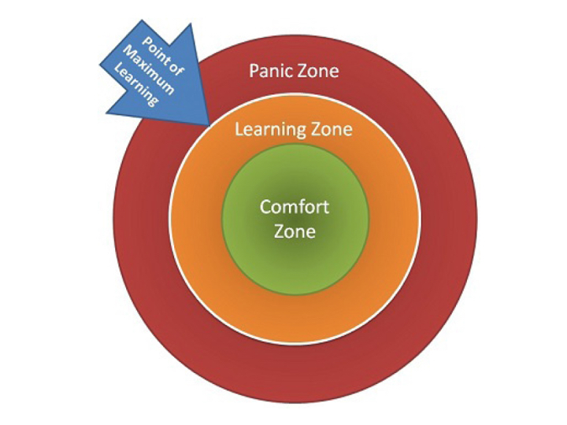
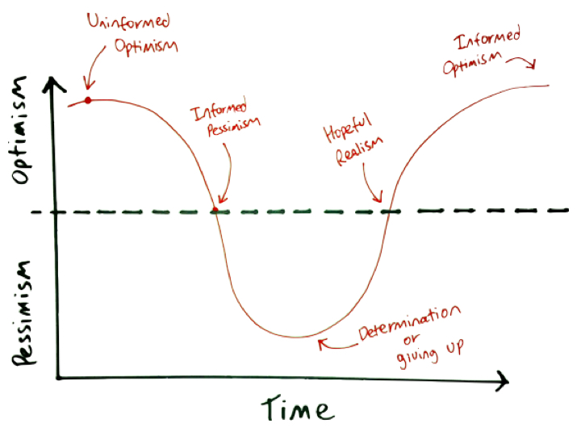

#   Welcome to SEI: Learning Experience + Classroom Culture (60 min)

| Timing | Type 
| --- | ---
| 10 min | [Your Instructional Team](#introduction) 
| 10 min | [Schedule](#expectations) 
| 10 min | [Big Goals and Culture](#ga-culture) 
| 10 min | [Student Expectations](#student-expectations) 
| 10 min | [Plagiarism](#plagiarism) 
| 10 min | [Student Work](#student-work)
|  | [Q&A](#questions) 

### LEARNING OBJECTIVES
*After this lesson, you will be able to:*

- Understand the expectations for the course.
- Align with the class on goals for the course.
- Get to know your classmates.
- Get familiar with class culture and big goals.

---

## Your Instructional Team (10 min)

#### Instructor Roles

1. Instructor Lead (Marc + Leo)
     - Lesson blocks
     - Code-alongs
     - Labs
     - Each instructor takes on a unit.
     - Grades projects
  
2. Instructor Associate (Thiago)
     - Morning exercises
     - Afternoon code reviews
     - Creates homework
     - Grades homework + projects

 

## Daily Schedule

We have a plan for this course, however, we reserve the right to make changes. 

#### Week 1

#### Week 2

#### Week 3

#### Week 4

#### Week 5

#### Week 6

#### Week 7 

#### Week 8

#### Week 9 

#### Week 10

#### Week 11

#### Week 12

#### Week 13

## Unit Breakdown

- Unit 1: Frontend fundamentals - Leo leads
- Unit 2: Node/Express/Postgres (Backend Development) - Marc leads
- Unit 3: React JS (Frontend Development) - Leo leads
- Unit 4: Python - Marc leads

 

## What to Expect (10 min)

#### Emotional Framing
- Programming is not about learning a sequence of steps. It's about developing a mindset to solve problems and think programmatically.
- Progamming language not as important as:
    - Critical/analytical/programmatic thinking.
    - Conceptualizing, not simply memorizing, ideas.
        - The internet is your notebook/memory.
    - Being able to adapt quickly.
- Deal with the chaos in your head. Being confused/lost is NORMAL. No one pays you because you know all the answers. A developer's job is to jump into confusion and find a solution.
- Development can be very personal. It's about:
	- Debugging your own mistakes.
	- Being a good "Googler" and reading tech documents, which takes practice.
	- Learning more by doing, rather than by listening.
- We try not to hold your hand.
	- There is a decent amount of failure that happens initially when learning web development.
		- It's good to get that out of the way before we start working.
- This course is hard work: Be prepared to devote 80-90 hours a week, minimum.
- The maximum point of learning is right at the edge of learning and panic.

 

 

- This experience will be a roller coaster.

 

 

## GA Big Goals and Culture (10 min)

- Big Goals: What do you want to accomplish in this course?
- Cutlure: How do you want to get there?

**YOU DO (10 min)**

In breakout rooms, discuss Big Goals and Culture for this course. We'll come back and share out.

	
Classroom Culture

#### Classroom Culture
- This is an open, safe environment.
- Keep criticism positive and constructive.
- Take ownership of your experience.
- Check your ego at the door.
- Channel empathy.
- Don't compare yourself to others, compare yourself to who you were yesterday.
- You get back what you put in.

#### Mentorship Culture
- GA collaborative and supportive; we lead with offering help.
- Some students are good at one thing, others at another. Leverage each other's strengths.
- Teaching is the best way of truly solidifying your understanding of a concept.
- Your classmates will be the best foundation for establishing a professional network in tech!

 

## Student Expectations (15 min)
1. Be Present.
     - We take attendance at 9:10 a.m. EST
     - Pay attention.
     - Please Slack message Thiago if you are running late
     - With regard to excused absences:
    	 - Multiple instances of tardiness = absence.
        - You must stay beneath the contractual limit of absences in order to successfully complete the course.
2. Be Persistent
3. Be Independent
4. Be Thoughtful
5. Be Creative
	- This coursework is not paint by numbers.
6. Be Alert and Mindful, not Distracted

 

## Plagiarism (10 min)

[Plagiarism Readme](plagiarism.md)

 

## Q&A
